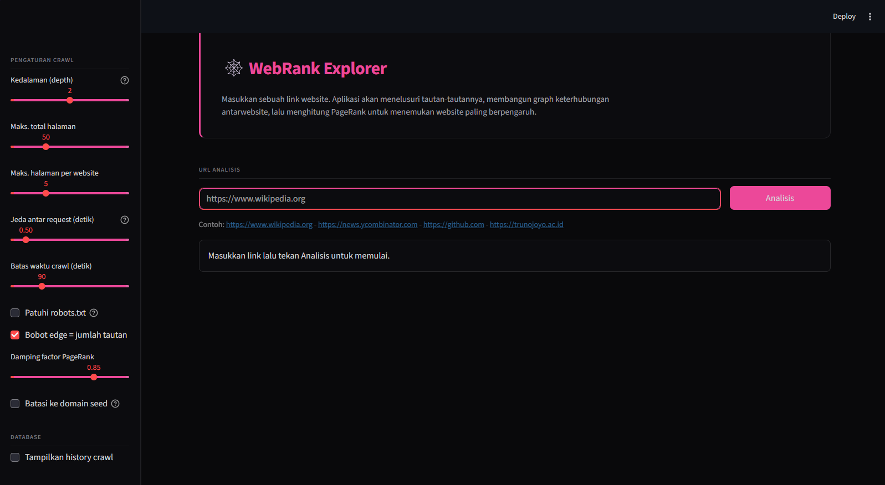
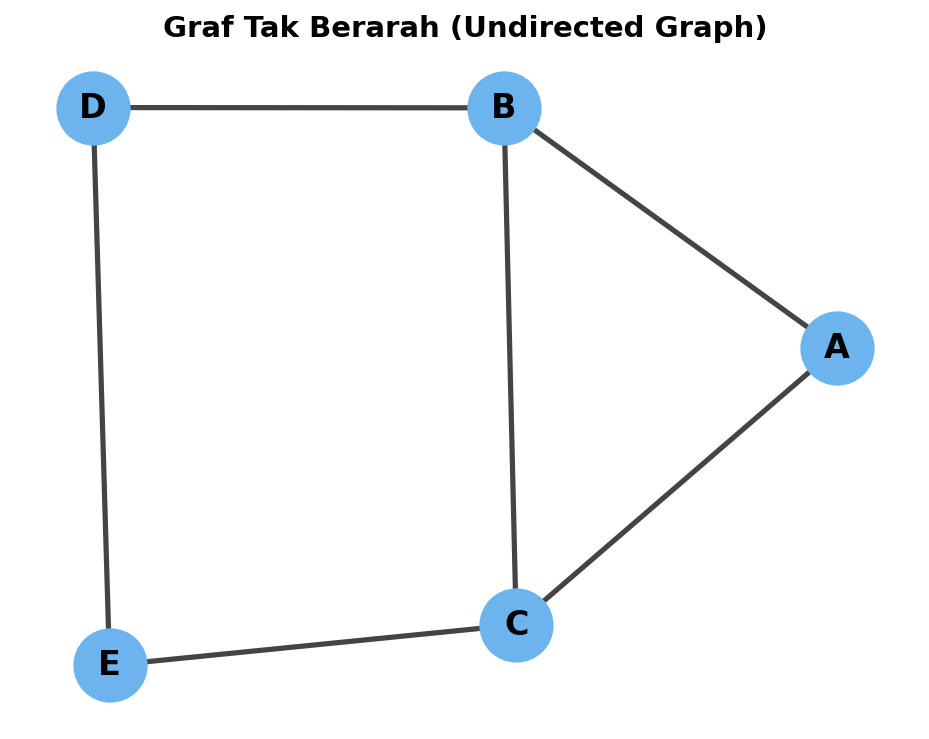
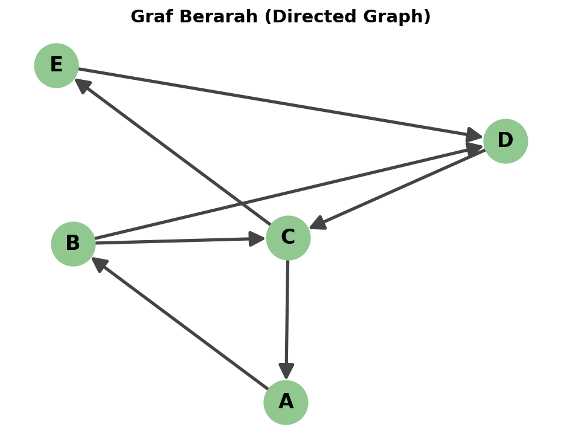
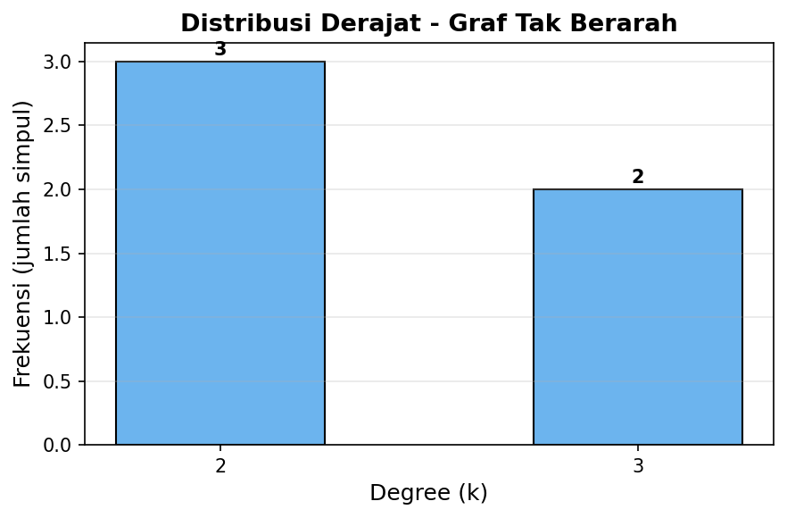
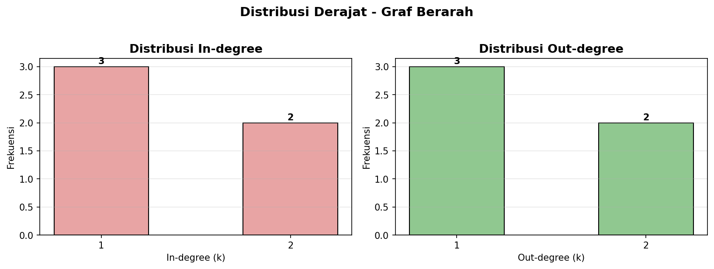
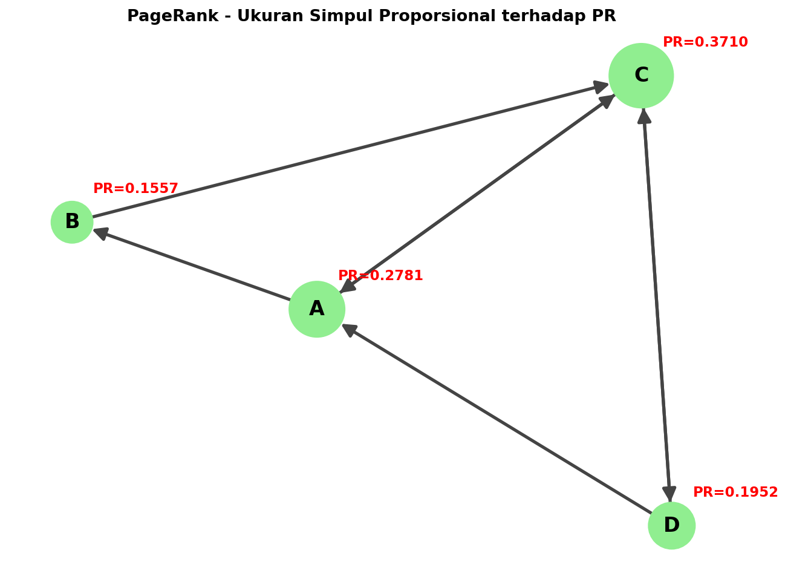

<p align="center">
  <strong>Tugas Mata Kuliah Web Structure Mining</strong>
</p>

<p align="center">
  
</p>

<p align="center">
  
  
  
  
  
</p>

---

## 📌 About This Repository

Repository ini berisi kumpulan tugas Web Structure Mining yang mencakup analisis graf menggunakan NetworkX, perhitungan PageRank, web crawling antarwebsite, serta proyek Web Content Mining untuk klasifikasi berita Indonesia menggunakan metodologi CRISP-DM.

Repository ini berisi seluruh tugas mata kuliah Web Structure Mining yang dibagi menjadi dua bagian utama.

### Part 1: Graph Analysis and PageRank

Bagian pertama membahas konsep Web Structure Mining melalui tiga notebook Jupyter yang disusun secara bertahap.

Materi mencakup analisis graf berarah dan tak berarah, representasi graf, perhitungan metrik graf, serta implementasi algoritma PageRank.

Bagian ini juga dilengkapi aplikasi Streamlit interaktif untuk melakukan web crawling dan analisis PageRank antarwebsite menggunakan data dari website nyata.

### Part 2: Web Content Mining (PPW)

Bagian kedua merupakan tugas mata kuliah Pencarian dan Penambangan Web (PPW) yang berfokus pada klasifikasi berita Indonesia ke dalam dua kategori, yaitu Sport dan Finance.

Proyek ini mengikuti metodologi CRISP-DM, mulai dari crawling artikel detik.com, eksplorasi dataset, text preprocessing, vektorisasi menggunakan TF-IDF, PCA, SVD, dan Skip-gram, pemodelan Naive Bayes, evaluasi model, hingga deployment aplikasi klasifikasi berbasis Streamlit.

---

### Application Preview

<p align="center">
  
</p>

<p align="center">
  <em>WebRank Explorer - Interactive Web Crawling and PageRank Analysis Interface</em>
</p>

## 📂 Repository Structure

```text
Web-Structure-Mining/
│
├── Analisis_Graf_NetworkX.ipynb
├── Analisis_PageRank_4Node.ipynb
├── Analisis_Crawl_PageRank.ipynb
│
├── README.md
├── requirements.txt
├── LICENSE
├── .gitignore
│
├── docs/
│   ├── index.html
│   ├── notebook_graf.html
│   ├── pagerank.html
│   └── images/
│
├── images/
│   ├── cover.png
│   ├── graf_pagerank_viz.png
│   ├── graf_tak_berarah.png
│   ├── graf_berarah.png
│   ├── dist_degree_undirected.png
│   ├── dist_degree_directed.png
│   └── pagerank_bar.png
│
├── web-crawler-pagerank/
│   ├── app.py
│   ├── crawler.py
│   ├── graph_builder.py
│   ├── database.py
│   ├── requirements.txt
│   ├── README.md
│   └── exports/
│
└── ppw/
    ├── CRISP-DM/
    │   ├── Business.ipynb
    │   ├── EDA.ipynb
    │   ├── Input.ipynb
    │   ├── Preprocessing.ipynb
    │   ├── Preprocessing_Ablation.ipynb
    │   ├── Vectorization.ipynb
    │   ├── Skipgram.ipynb
    │   ├── Modeling.ipynb
    │   ├── Skipgram_Classification.ipynb
    │   ├── Output.md
    │   └── Production.md
    │
    ├── data/
    ├── deployment/
    ├── enWebminig/
    ├── _config.yml
    ├── _toc.yml
    ├── intro.md
    └── README.md
```

### Directory Description

| Directory / File                | Description                                          |
| ------------------------------- | ---------------------------------------------------- |
| `Analisis_Graf_NetworkX.ipynb`  | Notebook 1, analisis graf 5 simpul                   |
| `Analisis_PageRank_4Node.ipynb` | Notebook 2, perhitungan PageRank 4 simpul            |
| `Analisis_Crawl_PageRank.ipynb` | Notebook 3, web crawling dan PageRank                |
| `docs/`                         | Dokumentasi statis untuk GitHub Pages                |
| `images/`                       | Gambar dan visualisasi untuk dokumentasi             |
| `web-crawler-pagerank/`         | Aplikasi web crawler dan PageRank berbasis Streamlit |
| `ppw/`                          | Proyek Web Content Mining menggunakan CRISP-DM       |
| `requirements.txt`              | Daftar dependencies utama                            |
| `LICENSE`                       | Lisensi MIT                                          |

---

# Part 1: Graph Analysis and PageRank

Bagian ini membahas analisis struktur hubungan antarwebsite menggunakan konsep graf dan algoritma PageRank.

## 1. Notebook 1: Graph Analysis with NetworkX

Notebook ini menganalisis dua jenis graf dengan masing-masing lima simpul, yaitu graf tak berarah (*Undirected Graph*) dan graf berarah (*Directed Graph*).

**Topics Covered:**

- Representasi graf menggunakan NetworkX.
- Matriks ketetanggaan (*Adjacency Matrix*).
- Perhitungan derajat simpul (*Degree*).
- In-degree dan out-degree.
- Distribusi derajat (*Degree Distribution*).
- Derajat rata-rata (*Average Degree*).
- Kepadatan graf (*Graph Density*).
- Lintasan terpendek (*Shortest Path*).
- Koefisien klasterisasi (*Clustering Coefficient*).

### Visualizations

<p align="center">
&#x20; 
&#x20; 
</p>

<p align="center">
&#x20; 
&#x20; 
</p>

## 2. Notebook 2: PageRank Analysis with 4 Nodes

Notebook ini membangun graf berarah dengan empat simpul dan melakukan perhitungan PageRank untuk menentukan tingkat kepentingan masing-masing simpul.

**Topics Covered:**

- Konstruksi graf berarah dengan NetworkX.
- Adjacency List.
- Edge List.
- Adjacency Matrix.
- Incidence Matrix.
- Perhitungan in-degree dan out-degree.
- Implementasi iterasi manual algoritma PageRank.
- Perhitungan PageRank menggunakan NetworkX.
- Perbandingan hasil perhitungan.

### PageRank Visualization

<p align="center">
  
</p>

### PageRank Results

Berikut hasil perhitungan PageRank untuk empat simpul:

| Node | In-degree | Out-degree | PageRank | Rank |
| ---- | --------: | ---------: | -------: | ---: |
| A    |         2 |          2 |   0.2781 |    2 |
| B    |         1 |          1 |   0.1557 |    4 |
| C    |         3 |          2 |   0.3710 |    1 |
| D    |         1 |          2 |   0.1952 |    3 |

<badge color="success">Highest PageRank</badge> **Node C** memperoleh skor PageRank tertinggi sebesar **0.3710**.

### PageRank Formula

Sumber: Bing Liu, *Web Data Mining*, Chapter 7.3.

```text
PR(i) = (1 - d) / N + d * Σ (PR(j) / D_out(j))
```

Keterangan:

- `PR(i)` adalah skor PageRank simpul i.
- `d` adalah damping factor dengan nilai default 0.85.
- `N` adalah jumlah seluruh simpul.
- `D_out(j)` adalah out-degree dari simpul j.
- `PR(j)` adalah skor PageRank simpul j.

## 3. Notebook 3: Web Crawling and PageRank

Notebook ini mendemonstrasikan proses web crawling untuk membangun directed graph berdasarkan hubungan tautan antarhalaman website nyata.

Beberapa website yang digunakan sebagai seed URL antara lain:

- [Wikipedia](https://www.wikipedia.org)
- [GitHub](https://github.com)
- [Universitas Trunojoyo Madura](https://trunojoyo.ac.id)

**Workflow:**

1. Menentukan seed URL.
2. Mengambil konten HTML website.
3. Mengekstraksi hyperlink.
4. Mengidentifikasi hubungan antarwebsite.
5. Membangun directed graph.
6. Menghitung PageRank setiap website.
7. Menganalisis website berdasarkan skor PageRank.

---

## 4. Web Crawler PageRank Analyzer

<badge color="success">Interactive Streamlit Application</badge>

Aplikasi web interaktif untuk melakukan crawling dan analisis PageRank antarwebsite secara real-time.

**Key Features:**

- Web crawler menggunakan BFS multi-level.
- Thread pool untuk paralelisasi proses crawling.
- Dukungan robots.txt.
- `curl_cffi` sebagai HTTP backend dengan dukungan TLS fingerprint impersonation.
- Visualisasi graph interaktif menggunakan PyVis dan vis.js.
- Force-directed graph layout.
- Top 10 website berdasarkan skor PageRank.
- Tabel dan bar chart hasil PageRank.
- Database SQLite untuk menyimpan riwayat crawling.
- Export hasil analisis ke GraphML, JSON, dan CSV.

**Project Location:**

```text
web-crawler-pagerank/
```

### How to Run

```bash
cd web-crawler-pagerank
pip install -r requirements.txt
streamlit run app.py
```

Buka aplikasi melalui browser:

```text
http://localhost:8501
```

Dokumentasi lengkap aplikasi tersedia di `web-crawler-pagerank/README.md`.

---

# Part 2: Web Content Mining (PPW)

## Indonesian News Classification: Sport vs Finance

Proyek Web Content Mining ini dikembangkan sebagai tugas mata kuliah Pencarian dan Penambangan Web (PPW) dengan menggunakan metodologi **Cross-Industry Standard Process for Data Mining (CRISP-DM)**.

Tujuan proyek adalah membangun sistem klasifikasi teks berita berbahasa Indonesia ke dalam dua kategori, yaitu Sport dan Finance.

Dataset dikumpulkan dari artikel berita [detik.com](https://www.detik.com/) melalui proses web crawling.

Proyek ini mengeksplorasi beberapa pendekatan representasi teks, termasuk TF-IDF, PCA, SVD, dan Skip-gram yang diimplementasikan secara manual.

Model klasifikasi menggunakan Naive Bayes dan dilengkapi dengan proses hyperparameter tuning serta deployment aplikasi Streamlit.

## Dataset Overview

Dataset terdiri dari 200 artikel berita berbahasa Indonesia.

| Category  | Number of Articles | ID Range  |
| --------- | -----------------: | --------- |
| Sport     |                100 | 1-100     |
| Finance   |                100 | 101-200   |
| **Total** |            **200** | **1-200** |

**Dataset Columns:**

| Column       | Description                         |
| ------------ | ----------------------------------- |
| `id`         | Identitas unik artikel              |
| `isi_berita` | Konten teks artikel berita          |
| `label`      | Kategori berita, Sport atau Finance |
| `url`        | Sumber URL artikel                  |

## CRISP-DM Methodology

Proyek ini mengikuti enam tahapan utama CRISP-DM.

### 1. Business Understanding

Mengidentifikasi permasalahan klasifikasi berita Indonesia dan menentukan tujuan serta kriteria keberhasilan proyek.

Notebook: `Business.ipynb`

### 2. Data Understanding

Melakukan eksplorasi awal terhadap 200 artikel berita yang telah dikumpulkan.

Analisis mencakup distribusi kategori, karakteristik dataset, dan pemeriksaan kualitas data.

Notebook: `EDA.ipynb`

### 3. Data Preparation

Tahapan persiapan data meliputi:

- Web crawling dan pengumpulan artikel berita.
- Ekstraksi konten artikel.
- Pelabelan kategori berita.
- Text preprocessing.
- Perbandingan tahapan preprocessing melalui ablation study.
- Ekstraksi fitur menggunakan TF-IDF.
- Dimensionality reduction menggunakan PCA dan SVD.
- Implementasi word embedding menggunakan Skip-gram secara manual.

**Related Notebooks:**

| Notebook                       | Description                                         |
| ------------------------------ | --------------------------------------------------- |
| `Input.ipynb`                  | Crawling dan pengumpulan dataset                    |
| `Preprocessing.ipynb`          | Text preprocessing                                  |
| `Preprocessing_Ablation.ipynb` | Perbandingan tahapan preprocessing                  |
| `Vectorization.ipynb`          | TF-IDF, PCA, dan SVD                                |
| `Skipgram.ipynb`               | Implementasi Skip-gram manual dengan demo 3 kalimat |

### 4. Modeling

Melakukan pemodelan klasifikasi berita menggunakan algoritma Naive Bayes.

Eksperimen dilakukan dengan beberapa representasi fitur:

- TF-IDF.
- PCA.
- SVD.
- Skip-gram.

Perbandingan Skip-gram dan TF-IDF dilengkapi dengan Grid Search untuk mengeksplorasi konfigurasi model.

**Related Notebooks:**

- `Modeling.ipynb`
- `Skipgram_Classification.ipynb`

### 5. Evaluation

Mengevaluasi performa model berdasarkan hasil eksperimen menggunakan berbagai representasi fitur.

Tahap ini bertujuan membandingkan hasil klasifikasi dan menentukan model dengan performa terbaik berdasarkan metrik evaluasi.

Notebook: `Output.md`

### 6. Deployment

Mengimplementasikan model klasifikasi ke dalam aplikasi web menggunakan Streamlit.

Aplikasi memungkinkan pengguna melakukan klasifikasi berita berdasarkan URL artikel dari detik.com.

Dokumentasi: `Production.md`

---

## 🚀 Running the PPW Application

Untuk menjalankan aplikasi klasifikasi berita:

**1. Masuk ke direktori PPW**

```bash
cd ppw
```

**2. Install dependencies**

```bash
pip install -r requirements.txt
```

**3. Jalankan aplikasi Streamlit**

```bash
streamlit run deployment/app.py
```

Aplikasi dapat diakses melalui browser pada alamat:

```text
http://localhost:8501
```

---

## 🌐 Live Demo and Documentation

Notebook untuk Bagian 1, yaitu Analisis Graf dan PageRank, tersedia dalam bentuk dokumentasi web statis melalui GitHub Pages.

<p align="center">
  <a href="https://haninhammoud01.github.io/web-mining-laboratory/">
    
  </a>
</p>

**Live Documentation:**

[https://haninhammoud01.github.io/analisis-graf-networkx/](https://haninhammoud01.github.io/web-mining-laboratory/)

Dokumentasi mencakup landing page, notebook analisis graf, dan notebook PageRank dalam format HTML.

---

## 💻 Running the Notebooks

Terdapat dua alternatif untuk menjalankan notebook Jupyter.

### Option 1: Google Colab

Jalankan notebook tanpa instalasi environment lokal.

1. Buka [Google Colab](https://colab.research.google.com).
2. Pilih **File > Upload notebook**.
3. Pilih notebook yang ingin dijalankan.
4. Sesuaikan runtime jika diperlukan.
5. Pilih **Runtime > Run all** untuk menjalankan seluruh cell.

### Option 2: Local Jupyter Notebook

**1. Clone repository**

```bash
git clone https://github.com/haninhammoud01/analisis-graf-networkx.git
```

**2. Masuk ke direktori repository**

```bash
cd analisis-graf-networkx
```

**3. Install dependencies**

```bash
pip install -r requirements.txt
```

**4. Jalankan Jupyter Notebook**

```bash
jupyter notebook
```

---

## 📖 Theoretical Concepts

### 1. Web Mining

Web Mining merupakan proses penerapan teknik data mining untuk menemukan pola, informasi, dan pengetahuan yang berguna dari data web.

Web Mining terbagi menjadi tiga kategori utama.

| Category             | Description                                                              | Implementation                      |
| -------------------- | ------------------------------------------------------------------------ | ----------------------------------- |
| Web Content Mining   | Mengekstraksi informasi dari konten halaman web, seperti teks dan gambar | Part 2: PPW                         |
| Web Structure Mining | Menganalisis struktur hubungan hyperlink antarhalaman web                | Part 1: Graph Analysis and PageRank |
| Web Usage Mining     | Mempelajari pola perilaku pengguna berdasarkan log aktivitas website     | Theoretical Study                   |

### 2. PageRank

PageRank merupakan algoritma yang diperkenalkan oleh Larry Page dan Sergey Brin untuk mengukur tingkat kepentingan halaman web berdasarkan struktur tautan.

Prinsip dasarnya adalah halaman yang menerima tautan dari banyak halaman penting berpotensi memiliki nilai PageRank yang tinggi.

PageRank juga berkaitan dengan konsep Prestige Rank dalam materi Web Structure Mining.

Konsep yang dipelajari meliputi:

- **Degree Prestige:** Mengukur prestise berdasarkan jumlah tautan masuk.
- **Proximity Prestige:** Mempertimbangkan kedekatan simpul terhadap simpul pemberi pengaruh.
- **Rank Prestige:** Mempertimbangkan tingkat prestise dari simpul yang memberikan tautan.
- **PageRank:** Mengembangkan konsep Rank Prestige dengan damping factor dan penanganan dangling nodes.

### 3. Directed Graph

Directed Graph atau graf berarah digunakan untuk merepresentasikan hubungan tautan antarwebsite.

| Component | Description                                     |
| --------- | ----------------------------------------------- |
| Node      | Website atau subdomain                          |
| Edge      | Tautan dari satu website menuju website lainnya |
| Weight    | Jumlah tautan dari website A menuju website B   |

Setiap subdomain diperlakukan sebagai node yang berbeda.

Contoh:

```text
en.wikipedia.org != fr.wikipedia.org
```

---

## 🛠️ Technologies and Tools

### Part 1: Graph Analysis and PageRank

| Technology       | Usage                                            |
| ---------------- | ------------------------------------------------ |
| Python 3.10+     | Bahasa pemrograman utama                         |
| NetworkX         | Konstruksi dan analisis graf                     |
| Streamlit        | Pengembangan aplikasi web                        |
| PyVis (vis.js)   | Visualisasi graf interaktif                      |
| curl_cffi        | HTTP client dengan TLS fingerprint impersonation |
| BeautifulSoup4   | Parsing dokumen HTML                             |
| Pandas           | Manipulasi data tabular                          |
| NumPy            | Komputasi numerik                                |
| SQLite           | Penyimpanan riwayat crawling                     |
| Jupyter Notebook | Eksperimen dan analisis interaktif               |

### Part 2: Web Content Mining (PPW)

| Technology   | Usage                                          |
| ------------ | ---------------------------------------------- |
| Python 3.10+ | Bahasa pemrograman utama                       |
| Trafilatura  | Ekstraksi teks artikel berita                  |
| Pandas       | Manipulasi dataset                             |
| scikit-learn | TF-IDF, PCA, SVD, Naive Bayes, dan Grid Search |
| NumPy        | Komputasi numerik                              |
| Streamlit    | Deployment aplikasi klasifikasi                |
| Jupyter Book | Dokumentasi proyek                             |

---

## 📚 References

1. Materi Perkuliahan, *Web Structure Mining*, Bab Mendeskripsikan Graf dan Prestise.
2. Liu, B. *Web Data Mining*, Chapter 7.3, PageRank.
3. Page, L., Brin, S., Motwani, R., & Winograd, T. (1999). *The PageRank Citation Ranking: Bringing Order to the Web*. Technical Report, Stanford InfoLab.

### Official Documentation

- [NetworkX Documentation](https://networkx.org/documentation/stable/)
- [Streamlit Documentation](https://docs.streamlit.io/)
- [PyVis Documentation](https://pyvis.readthedocs.io/)
- [curl_cffi Documentation](https://curl-cffi.readthedocs.io/)
- [scikit-learn Documentation](https://scikit-learn.org/)
- [Trafilatura Documentation](https://trafilatura.readthedocs.io/)
- [Jupyter Book Documentation](https://jupyterbook.org/)
- [BeautifulSoup Documentation](https://www.crummy.com/software/BeautifulSoup/bs4/doc/)

---

## 📄 License

This project is licensed under the [MIT License](LICENSE).

---

<div align="center">

**Hanin Hammoud**

Teknik Informatika  
Universitas Trunojoyo Madura

*Exploring Web Mining through Graph Analysis, PageRank, and Text Classification.*

</div>
